# AV Test — Cronometragem de Aceleração e Velocidade Final


Sistema distribuído de cronometragem para o **teste de aceleração e velocidade final** do veículo Baja da equipe **Mangue Baja (UFPE)**. Uma rede de módulos ESP32 comunicando-se por **ESP-NOW** mede os tempos de passagem do veículo em **30 m** e **100 m**, calcula a **velocidade final** a partir de dois sensores espaçados em 1 m (100 m e 101 m) e registra cada corrida em **cartão SD (CSV)**.

---

## Sumário

1. [Visão geral](#1-visão-geral)
2. [Como uma corrida acontece (visão de ponta a ponta)](#2-como-uma-corrida-acontece-visão-de-ponta-a-ponta)
3. [Arquitetura de software](#3-arquitetura-de-software)
4. [Topologia de rede e roteamento](#4-topologia-de-rede-e-roteamento)
5. [Protocolo de comunicação](#5-protocolo-de-comunicação)
6. [Máquinas de estado](#6-máquinas-de-estado)
7. [Fluxogramas do firmware](#7-fluxogramas-do-firmware)
8. [Medição de tempo e velocidade](#8-medição-de-tempo-e-velocidade)
9. [Hardware e pinagem](#9-hardware-e-pinagem)
10. [Interface com o usuário (LCD e botões)](#10-interface-com-o-usuário-lcd-e-botões)
11. [Armazenamento no cartão SD](#11-armazenamento-no-cartão-sd)
12. [Referência rápida das bibliotecas internas](#12-referência-rápida-das-bibliotecas-internas)
13. [Estrutura do repositório](#13-estrutura-do-repositório)
14. [Compilação e gravação](#14-compilação-e-gravação)
15. [Guia de operação em pista](#15-guia-de-operação-em-pista)
16. [Solução de problemas](#16-solução-de-problemas)
17. [Limitações conhecidas e melhorias sugeridas](#17-limitações-conhecidas-e-melhorias-sugeridas)
18. [Equipe](#18-equipe)

---

## 1. Visão geral

O sistema é composto por **três posições de medição** (mais um repetidor opcional). Todas rodam o **mesmo firmware**; o papel de cada placa é escolhido em tempo de compilação pela constante `MODE` em `src/main.cpp`.

| Posição | `ModuleID` | Classe | Papel |
|---|---|---|---|
| 0 m (largada) | `ECU` | `Module0m` | Mestre da rede. Detecta a largada, coordena a máquina de estados dos demais módulos, exibe tempos no LCD e grava o resultado no SD. |
| 30 m | `Sensor30m` | `Module30m` | Captura o tempo de passagem por **interrupção** de hardware e atua como **relé** entre a ECU e o módulo de 100 m. |
| 100 m | `Sensor100m` | `Module100m` | Captura dois tempos consecutivos (100 m e 101 m) por **polling**, possibilitando o cálculo da velocidade final. |
| Opcional | `Bridge` | `BridgeModule` | Repetidor de broadcasts ESP-NOW com cache de `message_id` (anti-loop). |

**Principais características**

- Comunicação sem fio, sem infraestrutura (sem roteador): **ESP-NOW** sobre Wi-Fi em modo STA.
- Interface comum `IModule` — `main.cpp` instancia qualquer módulo de forma genérica.
- **Um único formato de pacote** (`av_packet_t`) para toda a rede.
- Descoberta automática de módulos (handshake `check_module` → `flag_30m` / `flag_100m`).
- Velocidade final calculada por **diferença de tempos medidos no mesmo relógio**, o que cancela o erro de sincronismo entre módulos (ver [seção 8](#8-medição-de-tempo-e-velocidade)).
- Registro persistente em CSV, com um arquivo novo a cada inicialização da ECU.

---

## 2. Como uma corrida acontece (visão de ponta a ponta)

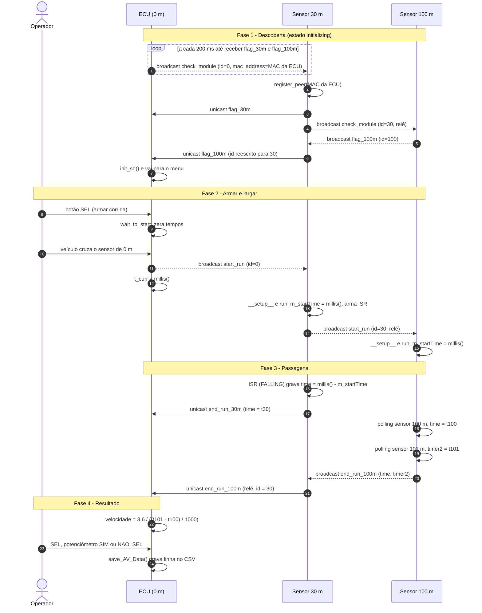

Legenda: seta tracejada (`-->>`) = **broadcast**; seta cheia (`->>`) = **unicast** ou ação local.

---

## 3. Arquitetura de software

### 3.1 Camadas

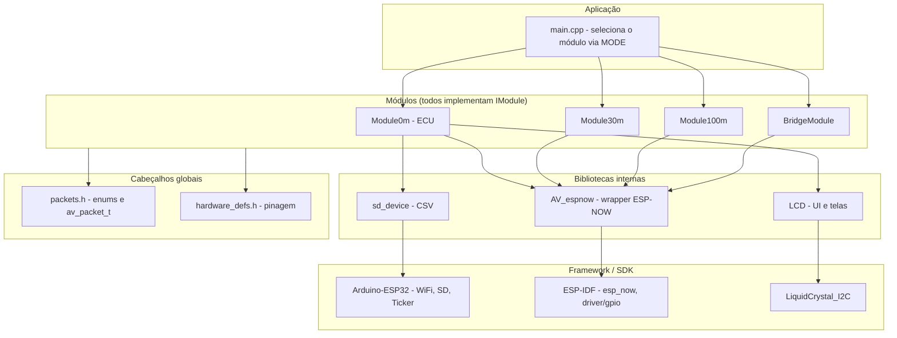

### 3.2 Diagrama de classes

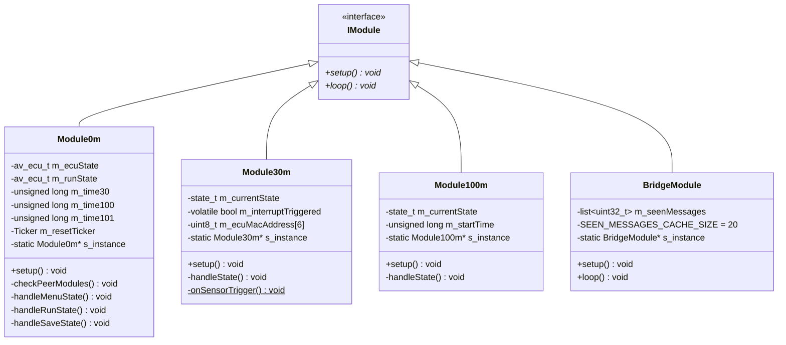

### 3.3 Padrões de projeto usados

| Padrão | Onde | Motivo |
|---|---|---|
| **Interface / polimorfismo** (`IModule`) | `main.cpp` | Um único ponto de entrada para qualquer papel da rede. |
| **Instância estática (`s_instance`)** | Todos os módulos | Os callbacks do ESP-NOW e a ISR são funções C estáticas; `s_instance` permite despachá-los para métodos da instância. |
| **Máquina de estados** | `Module0m`, `Module30m`, `Module100m` | Fluxo da corrida determinístico e fácil de auditar. |
| **Relé (store-and-forward)** | `Module30m`, `BridgeModule` | Estende o alcance e liga a ECU ao módulo de 100 m. |

> **Nota de projeto:** em `Module0m`, `Module30m` e `Module100m`, `setup()` **não retorna** — ele entra em `runMainLoop()` (laço infinito com `vTaskDelay(10 ms)`). Por isso `loop()` desses módulos é vazio e nunca chega a ser executado pelo Arduino. Apenas o `BridgeModule` usa `loop()` de fato.

---

## 4. Topologia de rede e roteamento

Todos os nós operam em **Wi-Fi modo STA sem conexão a AP**, portanto compartilham o mesmo canal padrão e se comunicam por ESP-NOW **sem criptografia** (`peerInfo.encrypt = false`).

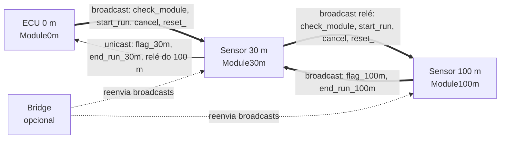

> O módulo de 100 m **não fala diretamente com a ECU**: todo o tráfego entre eles passa pelo módulo de 30 m, que reescreve o campo `id` do pacote para `metros_30`. Se o módulo de 30 m estiver fora do ar, a ECU nunca confirma o de 100 m.

### 4.1 Matriz de filtragem (quem aceita o quê)

Cada módulo filtra pelo campo `id` (**último salto**, ver seção 5.3):

| Receptor | Aceita pacotes com `id ==` | Ação |
|---|---|---|
| **ECU** | `metros_30` | Trata `flag_30m`, `flag_100m`, `end_run_30m`, `end_run_100m`. Ignora todo o resto, inclusive pacotes diretos do 100 m. |
| **30 m** | `metros_0` | `check_module`, `start_run`, `cancel`, `reset_` — executa e **retransmite** (com `id = metros_30`). |
| **30 m** | `metros_100` | Repassa em **unicast** para a ECU (com `id = metros_30`). |
| **100 m** | `metros_30` | `check_module`, `start_run`, `cancel`, `reset_`. Ignora pacotes com `id = metros_0` (mesmo se ouvir a ECU diretamente). |
| **Bridge** | qualquer | Reenvia em broadcast, se o `message_id` ainda não estiver no cache. |

### 4.2 Catálogo de mensagens

| Mensagem | Origem → Destino | Modo | `id` no ar | Campos úteis |
|---|---|---|---|---|
| `check_module` | ECU → todos | broadcast | `0` | `mac_address` = MAC da ECU |
| `check_module` (relé) | 30 m → todos | broadcast | `1` | idem |
| `flag_30m` | 30 m → ECU | unicast | `1` | — |
| `flag_100m` | 100 m → todos | broadcast | `2` | — |
| `flag_100m` (relé) | 30 m → ECU | unicast | `1` | — |
| `start_run` | ECU → todos | broadcast | `0` | — |
| `start_run` (relé) | 30 m → todos | broadcast | `1` | — |
| `end_run_30m` | 30 m → ECU | unicast | `1` | `time` = t30 (ms) |
| `end_run_100m` | 100 m → todos | broadcast | `2` | `time` = t100, `timer2` = t101 (ms) |
| `end_run_100m` (relé) | 30 m → ECU | unicast | `1` | idem |
| `cancel` | ECU → todos (+ relé 30 m) | broadcast | `0` / `1` | — |
| `reset_` | ECU → todos (+ relé 30 m) | broadcast | `0` / `1` | Módulos reiniciam com `esp_restart()` |

---

## 5. Protocolo de comunicação

Toda a comunicação usa a struct única `av_packet_t` (`include/packets.h`). O receptor descarta qualquer frame cujo tamanho seja diferente de `sizeof(av_packet_t)`.

### 5.1 Identificação dos módulos — `module_t`

| Valor | Nome | Descrição |
|---|---|---|
| `0` | `metros_0` | ECU (0 m), com LCD e cartão SD |
| `1` | `metros_30` | Sensor de 30 m |
| `2` | `metros_100` | Sensor de 100/101 m |
| `3` | `bridge` | Ponte/repetidor |

### 5.2 Comandos — `state_machine_command_t`

| Valor | Nome | Enviado por | Descrição |
|---|---|---|---|
| `0xFF` | `do_nothing` | — | Comando nulo (valor padrão do campo) |
| `0x00` | `check_module` | ECU | Descobre quais módulos estão online |
| `0x03` | `cancel` | ECU | Cancela a corrida em andamento |
| `0x04` | `start_run` | ECU | Inicia a cronometragem em todos os módulos |
| `0x05` | `flag_30m` | 30 m | Confirmação de presença do módulo de 30 m |
| `0xFA` | `end_run_30m` | 30 m | Tempo de passagem em 30 m (`~0x05`) |
| `0x06` | `flag_100m` | 100 m | Confirmação de presença do módulo de 100 m |
| `0xF9` | `end_run_100m` | 100 m | Tempos em 100 m e 101 m (`~0x06`) |
| `0x07` | `reset_` | ECU | Reinicia todos os módulos |

> `end_run_*` é definido como o **complemento bit a bit** da flag correspondente (`uint8_t(~0x05)` e `uint8_t(~0x06)`).

### 5.3 Estrutura do pacote — `av_packet_t`

| Campo | Tipo | Offset* | Descrição |
|---|---|---|---|
| `message_id` | `uint32_t` | 0 | ID da mensagem para deduplicação no `BridgeModule`. |
| `original_sender_mac` | `uint8_t[6]` | 4 | MAC de quem originou a mensagem (reservado para a rede adaptativa). |
| `id` | `uint8_t` | 10 | **Último salto**: módulo que enviou/retransmitiu este frame (`module_t`). É o campo usado na filtragem. |
| `command_for_state_machine` | `uint8_t` | 11 | Comando (`state_machine_command_t`). |
| `mac_address` | `uint8_t[6]` | 12 | MAC da ECU, enviado em `check_module` para que o módulo de 30 m registre a ECU como *peer* e responda em unicast. |
| *(padding)* | — | 18 | 2 bytes de alinhamento inseridos pelo compilador. |
| `time` | `unsigned long` | 20 | Tempo principal em **ms** (t30 ou t100). |
| `timer2` | `unsigned long` | 24 | Tempo secundário em **ms** (t101). |

\* Offsets e tamanho total (**28 bytes**) calculados para ESP32 (Xtensa 32 bits, `unsigned long` = 4 bytes, struct sem `packed`). Todos os nós devem ser compilados com o mesmo toolchain/arquitetura. O limite do ESP-NOW é de 250 bytes por frame.

---

## 6. Máquinas de estado

### 6.1 ECU (`av_ecu_t`)

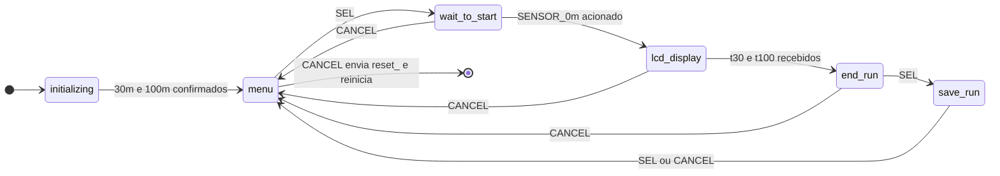

| Estado | Valor | Descrição |
|---|---|---|
| `initializing` | `-1` | Envia `check_module` em broadcast a cada 200 ms até receber `flag_30m` e `flag_100m`; depois inicializa o SD. |
| `menu` | `0` | Tela inicial. SEL arma uma corrida; CANCEL reinicia toda a rede. |
| `__start_run__` | `1` | Estado "guarda-chuva" da corrida; delega aos sub-estados abaixo. |
| `wait_to_start` | `2` | Zera tempos e aguarda o sensor de 0 m. |
| `lcd_display` | `3` | Cronômetro ao vivo no LCD até chegarem t30 e t100. |
| `end_run` | `4` | Mostra resultado e calcula a velocidade. |
| `save_run` | `5` | Pergunta "DESEJA SALVAR?" e grava no SD. |

### 6.2 Sensores remotos (`state_t`)

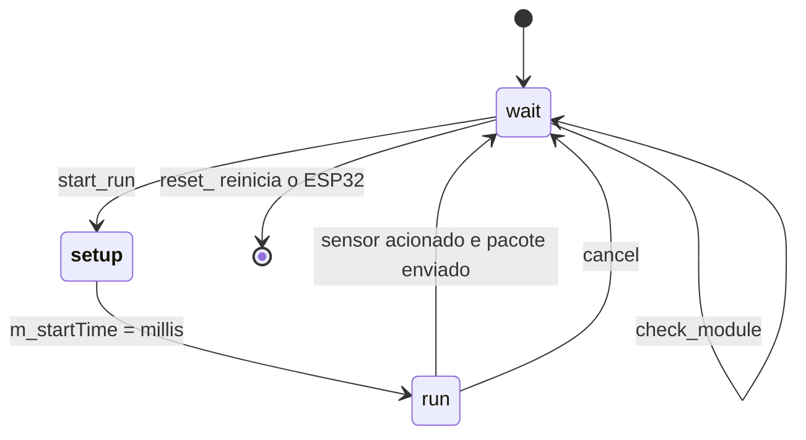

| Estado | Valor | Módulo 30 m | Módulo 100 m |
|---|---|---|---|
| `wait` | `0` | Garante ISR desanexada | Ocioso |
| `__setup__` | `1` | Salva `m_startTime`, zera flag da ISR | Salva `m_startTime` |
| `run` | `2` | Arma ISR (`FALLING`) e aguarda a flag | *Polling* do sensor de 100 m e depois do de 101 m |

---

## 7. Fluxogramas do firmware

### 7.1 ECU — laço principal

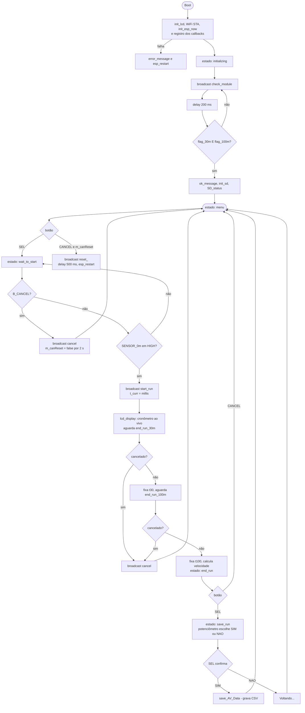

### 7.2 Módulo de 30 m — tratamento de pacotes e corrida

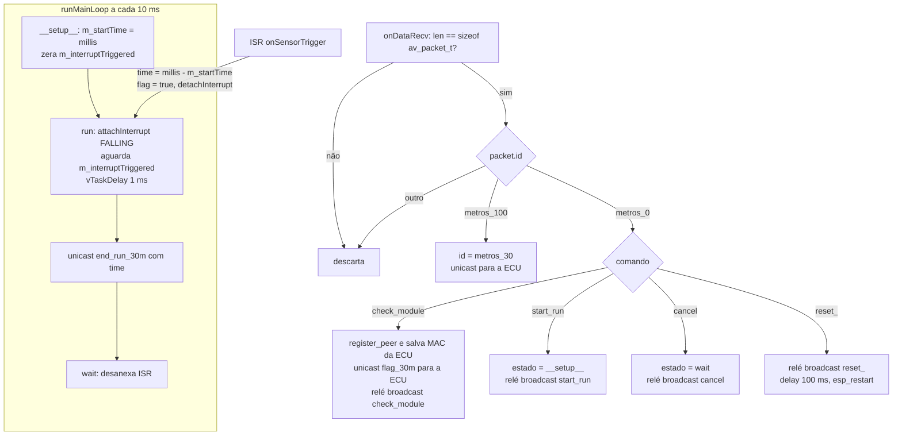

### 7.3 Módulo de 100 m — corrida

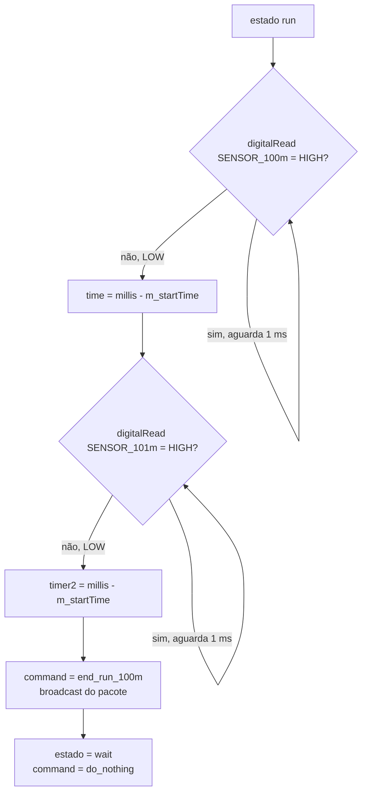

### 7.4 Bridge — anti-loop

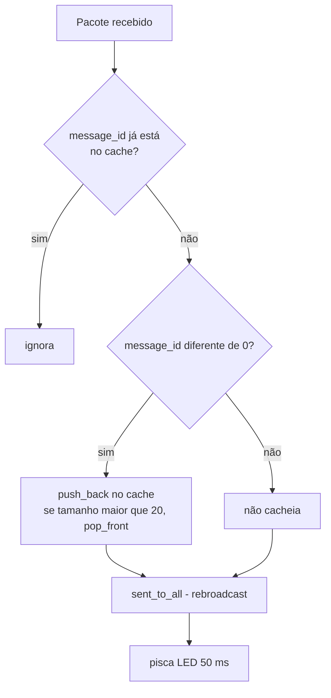

---

## 8. Medição de tempo e velocidade

### 8.1 Referências de tempo

Não há relógio global compartilhado. Cada módulo mede **tempos relativos ao recebimento do `start_run`**:

| Módulo | Instante zero | Captura |
|---|---|---|
| ECU | `millis()` logo após enviar `start_run` (`t_curr`) | Apenas para o cronômetro ao vivo no LCD. |
| 30 m | `millis()` ao entrar em `__setup__` | ISR `FALLING` → `millis() - m_startTime` |
| 100 m | `millis()` ao entrar em `__setup__` | *Polling* a cada `vTaskDelay(1)`; duas capturas no mesmo relógio |

Os tempos oficiais gravados no SD (`t30`, `t100`) são os **medidos pelos sensores remotos**, não o cronômetro ao vivo da ECU.

### 8.2 Velocidade final

Os sensores de 100 m e 101 m estão espaçados em **1,000 m**, e ambos os tempos são medidos **pelo mesmo ESP32 com o mesmo `millis()`**. Qualquer deslocamento do instante zero se cancela na subtração:

```
Δt   = t101 − t100                (ms)
v    = 1 m / (Δt / 1000)          (m/s)
v    = v × 3,6                    (km/h)   ⇒   v[km/h] = 3600 / Δt[ms]
```

| Δt entre 100 m e 101 m | Velocidade |
|---|---|
| 72 ms | 50 km/h |
| 48 ms | 75 km/h |
| 36 ms | 100 km/h |

O cálculo é feito na ECU em `handleSaveState()` (valor gravado) e em `save_speed()` (valor exibido), com a guarda `t101 > t100 && t100 > 0`. Se a guarda falhar, o LCD mostra `--.-- km/h` e o SD recebe `0.000000`.

### 8.3 Fontes de erro (orçamento)

| Fonte | Ordem de grandeza | Afeta | Observação |
|---|---|---|---|
| Resolução de `millis()` | 1 ms | t30, t100, Δt | Quantização das capturas. |
| *Polling* no módulo de 100 m | ≈ 1 ms (tick padrão do Arduino-ESP32) | t100, t101 | O 30 m usa ISR e não sofre disso. |
| Detecção da largada na ECU | até 10 ms | zero de referência | O sensor de 0 m é lido a cada iteração de 10 ms do laço principal. |
| Laço de estado dos sensores remotos | até 10 ms | zero de referência | `__setup__` só é processado no próximo tick do `runMainLoop`. |
| Latência de rádio ESP-NOW (e relé via 30 m para o 100 m) | poucos ms | zero de referência | — |
| Distância real entre sensores 100/101 m | 1 cm ≈ 1 % | velocidade | Meça e fixe a base com cuidado. |

**Consequências práticas**

- `t30` e `t100` tendem a sair **ligeiramente menores** que o tempo real desde o cruzamento físico da linha de 0 m (o zero dos remotos é o *recebimento* do comando, que ocorre depois da largada). Trate o viés como sistemático.
- **Velocidade:** o erro de ±1 ms em Δt corresponde a aproximadamente **±1,4 % a 50 km/h** e **±2,8 % a 100 km/h**. O zero de referência não afeta a velocidade.

---

## 9. Hardware e pinagem

### 9.1 Lista de materiais por módulo

| Módulo | Componentes |
|---|---|
| **ECU (0 m)** | ESP32, LCD 16x2 com backpack I2C (`0x27`), módulo SD (SPI), potenciômetro, 2 botões (SEL e CANCEL), sensor de largada |
| **30 m** | ESP32, sensor de passagem com saída digital |
| **100 m** | ESP32, 2 sensores de passagem com saída digital (espaçados em 1 m) |
| **Bridge** | ESP32 (opcional) |

### 9.2 Pinos (`include/hardware_defs.h`)

| Constante | GPIO | Módulo | Função | Configuração |
|---|---|---|---|---|
| `SD_CS` | 2 | 0 m | Chip Select do SD | — |
| `POT` | 35 | 0 m | Seleção SIM/NAO (ADC) | `INPUT` |
| `B_SEL` | 14 | 0 m | Seleção/confirmação | `INPUT_PULLUP` (ativo em LOW) |
| `B_CANCEL` | 13 | 0 m | Cancelar/Reset | `INPUT_PULLUP` (ativo em LOW) |
| `SENSOR_0m` | 15 | 0 m | Sensor de largada | `INPUT_PULLUP` |
| `SENSOR_30m` | 5 | 30 m | Sensor de 30 m | `INPUT_PULLUP`, interrupção `FALLING` |
| `SENSOR_100m` | 5 | 100 m | Sensor de 100 m | `INPUT_PULLUP`, *polling* até LOW |
| `SENSOR_101m` | 18 | 100 m | Sensor de 101 m | `INPUT_PULLUP`, *polling* até LOW |

Periféricos que usam pinos **padrão do core Arduino-ESP32** (não definidos no projeto):

| Periférico | Pinos padrão |
|---|---|
| LCD I2C (`LiquidCrystal_I2C`, endereço `0x27`, 16x2) | SDA = GPIO21, SCL = GPIO22 |
| SD (SPI/VSPI, CS = GPIO2) | SCK = GPIO18, MISO = GPIO19, MOSI = GPIO23 |

### 9.3 Polaridade dos sensores

| Ponto | Leitura | Condição de disparo |
|---|---|---|
| 0 m | `digitalRead(SENSOR_0m)` | **HIGH** inicia a corrida |
| 30 m | interrupção | borda de descida (**FALLING**) |
| 100 m / 101 m | `digitalRead` | **LOW** registra a passagem |

> Atenção: o sensor de 0 m dispara em **nível alto**, ao contrário dos demais. Isso exige um sensor/condicionamento que mantenha o pino em LOW enquanto o veículo **não** passou. Confirme a polaridade de cada sensor antes de usar em pista.

### 9.4 Esquema de ligação (ECU)

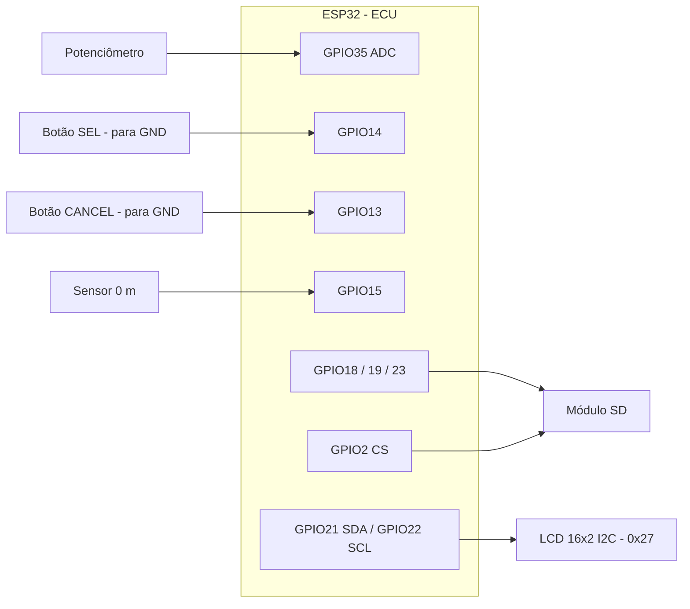

### 9.5 Observações elétricas

- **Pinos de *strapping* do ESP32:** GPIO2, GPIO5 e GPIO15 influenciam o boot. Evite que o circuito externo (sensor, SD) force níveis nesses pinos durante a energização.
- **GPIO35** é apenas entrada, sem *pull-up* interno (adequado ao potenciômetro).
- Em placas DevKit como a `esp32dev`, `LED_BUILTIN` costuma ser o **GPIO2**, o mesmo pino do CS do SD na ECU.
- No módulo de 100 m, o GPIO18 é usado como sensor; ali não há SD, portanto não há conflito com o SPI.

---

## 10. Interface com o usuário (LCD e botões)

### 10.1 Telas (LCD 16x2)

```
Inicialização         Confirmações             Menu
┌────────────────┐    ┌────────────────┐      ┌────────────────┐
│Iniciando...    │    │ESP-NOW ok!     │      │MANGUE AV - 4x4 │
│                │    │SD instalado    │      │ > RUN          │
└────────────────┘    └────────────────┘      └────────────────┘

Corrida                                       Salvar?
┌────────────────┐                            ┌────────────────┐
│ 00:000  00:000 │  (t30)   (t100)            │ DESEJA SALVAR? │
│   00.00 km/h   │                            │ > SIM    NAO   │
└────────────────┘                            └────────────────┘
```

### 10.2 Ação dos botões por estado

| Estado da ECU | SEL | CANCEL |
|---|---|---|
| `menu` | Arma a corrida (`wait_to_start`) | Envia `reset_` em broadcast e reinicia a ECU (inibido por 2 s após um cancelamento) |
| `wait_to_start` | — | Envia `cancel`, volta ao menu e inibe o reset por 2 s |
| `lcd_display` | — | Envia `cancel` e volta ao menu |
| `end_run` | Vai para `save_run` | Volta ao menu sem salvar |
| `save_run` | Confirma a opção do potenciômetro | Volta ao menu |

Seleção SIM/NAO: leitura ADC do potenciômetro; `0 – 2047` = **SIM**, `2048 – 4095` = **NAO**.

---

## 11. Armazenamento no cartão SD

- O SD só é inicializado **após** a ECU confirmar os módulos de 30 m e 100 m.
- A cada inicialização é criado `/AV_dataN.csv`, onde `N` é a **quantidade de arquivos (não diretórios) existentes na raiz** do cartão naquele momento.
- Cada corrida salva é uma linha em modo *append*. Tempos em **milissegundos**, velocidade em **km/h**.

```csv
tempo_30,tempo_100,velocidade
2874,8312,41.860466
2791,8150,43.902439
```

| Coluna | Unidade | Origem |
|---|---|---|
| `tempo_30` | ms | `end_run_30m.time` |
| `tempo_100` | ms | `end_run_100m.time` |
| `velocidade` | km/h | `3600 / (t101 − t100)` |

> Os valores acima são **exemplos ilustrativos** do formato.

---

## 12. Referência rápida das bibliotecas internas

### `AV_espnow`

| Função | Descrição |
|---|---|
| `bool init_esp_now()` | Inicializa o ESP-NOW. |
| `bool register_peer(uint8_t* mac)` | Adiciona um peer (canal 0, sem criptografia). |
| `bool register_receive_callback(cb)` | Registra callback de recepção `(mac, data, len)`. |
| `bool register_transmitter_callback(cb)` | Registra callback de status de envio. |
| `bool sent_to_all(void* msg, int size)` | Broadcast `FF:FF:FF:FF:FF:FF` (adiciona o peer de broadcast se necessário). |
| `bool sent_to_single(void* msg, int size, uint8_t* mac)` | Unicast; o peer deve estar registrado. |

> Os retornos indicam apenas que o envio foi **enfileirado** com sucesso, não que o destinatário recebeu.

### `LCD`

| Grupo | Funções |
|---|---|
| Inicialização/status | `init_lcd`, `error_message`, `ok_message`, `SD_status`, `display_run_error` |
| Telas | `intro_text`, `select_sd`, `display_save_result`, `display_returning_message` |
| Dados da corrida | `start_the_av_run`, `save_tcurr_time`, `printRun` (3 sobrecargas), `format_time`, `save_t30`, `save_t100`, `save_speed` |

### `sd_device`

| Função | Descrição |
|---|---|
| `bool init_sd(uint8_t pin)` | Inicializa o SD, define o nome do arquivo e escreve o cabeçalho CSV. |
| `bool save_AV_Data(t30, t100, v)` | Acrescenta uma linha ao CSV. |

---

## 13. Estrutura do repositório

```
AV Test/
├── backup/              # Versões anteriores
├── include/
│   ├── hardware_defs.h  # Pinagem
│   └── packets.h        # Enums e av_packet_t
├── lib/
│   ├── AV_espnow/       # Wrapper ESP-NOW
│   ├── Bridge/          # BridgeModule
│   ├── IModule/         # Interface base
│   ├── LCD/             # Telas e formatação
│   ├── Module0m/        # ECU
│   ├── Module30m/       # Sensor 30 m
│   ├── Module100m/      # Sensor 100 m
│   └── SD/              # sd_device (CSV)
├── src/
│   └── main.cpp         # Seleção do módulo via MODE
├── platformio.ini
└── README.md
```

### Dependências

| Biblioteca | Fonte | Uso |
|---|---|---|
| `esp_now.h` | ESP-IDF / Arduino-ESP32 | ESP-NOW |
| `WiFi.h` | Arduino-ESP32 | Modo STA e leitura do MAC |
| `Ticker.h` | Arduino-ESP32 | Reabilita o reset da ECU após cancelamento |
| `SD.h` | Arduino-ESP32 | Cartão SD |
| `driver/gpio.h` | ESP-IDF | Constantes `GPIO_NUM_x` |
| `LiquidCrystal_I2C` | Externa | LCD 16x2 via I2C |

---

## 14. Compilação e gravação

Requer [PlatformIO](https://platformio.org/).

### 14.1 Escolha do papel da placa

Em `src/main.cpp`:

```cpp
#define MODE ModuleID::Sensor100m   // ECU | Sensor30m | Sensor100m | Bridge
```

### 14.2 Gravar e monitorar

```bash
pio run --target upload      # compila e grava
pio device monitor           # monitor serial (115200 baud)
```

Repita para cada ESP32, trocando o `MODE` a cada gravação.

### 14.3 Exemplo de `platformio.ini`

> Exemplo ilustrativo; ajuste placa e versões ao seu ambiente.

```ini
[env:esp32dev]
platform = espressif32
board = esp32dev
framework = arduino
monitor_speed = 115200
lib_deps =
    marcoschwartz/LiquidCrystal_I2C
```

### 14.4 Saídas esperadas no monitor serial

| Módulo | Mensagens |
|---|---|
| ECU | `Mac address: ...`, `AV ECU OK!`, `Procurando módulos...`, `Módulo 30m confirmado.`, `Módulo 100m confirmado.` |
| 30 m | `Mac address: ...`, `30 metros OK!`, `Peer (ECU) registrado.` |
| 100 m | `Mac address: ...`, `100 metros OK!` |
| Bridge | `Módulo Bridge MAC Address: ...`, `Pacote #N retransmitido com sucesso.` |

---

## 15. Guia de operação em pista

1. **Posicione os sensores:** 0 m (largada), 30 m e o par 100 m / 101 m (distância **exata de 1 m** entre eles). Confirme a polaridade (seção 9.3).
2. **Energize** os módulos de 30 m e 100 m (a ordem entre eles não importa).
3. **Energize a ECU.** Ela exibe `Iniciando...` enquanto procura módulos, depois `ESP-NOW ok!` e `SD instalado` (ou `Nao ha SD`).
4. No menu (`> RUN`), pressione **SEL** para armar a corrida.
5. O veículo cruza o sensor de 0 m: a ECU dispara `start_run` e o cronômetro começa no LCD.
6. Após o veículo passar por 30 m, 100 m e 101 m, a ECU mostra `t30`, `t100` e a velocidade.
7. Pressione **SEL**, escolha **SIM/NAO** com o potenciômetro e **SEL** novamente para confirmar.
8. Para abortar: **CANCEL** durante a espera ou a corrida. Para reiniciar toda a rede: **CANCEL** no menu.

---

## 16. Solução de problemas

| Sintoma | Causa provável | O que verificar |
|---|---|---|
| LCD travado em `Iniciando...` | ECU não recebeu `flag_30m` e/ou `flag_100m` | Módulos ligados? Distância? O 100 m só confirma via módulo de 30 m. Veja o serial: `Módulo ... confirmado.` |
| `ESP-NOW ERROR` e reinício | Falha em `esp_now_init` ou registro de callbacks | Reinicie; verifique o firmware gravado. |
| `Nao ha SD` | Falha em `SD.begin` ou na criação do arquivo | Cartão, formatação (FAT32), ligações SPI e CS (GPIO2). |
| Corrida inicia sozinha ao armar | Polaridade do sensor de 0 m (dispara em HIGH) | Nível do pino com o sensor em repouso. |
| `t100` / velocidade `--.-- km/h` | Falta `timer2` ou `t101 <= t100` | Ordem física dos sensores 100/101 e polaridade. |
| Cronômetro roda e nunca termina | Pacote `start_run` ou `end_run_*` perdido (broadcast sem confirmação) | Use CANCEL e repita; aproxime os módulos ou use o Bridge. |
| Corrida cancelada mas um módulo ainda reporta tempo | Cancelamento não interrompe a espera bloqueante do remoto (seção 17) | Reinicie a rede com CANCEL no menu. |

---

## 17. Limitações conhecidas e melhorias sugeridas

Pontos levantados na revisão do código atual, ordenados por impacto prático.

| # | Ponto | Impacto | Sugestão |
|---|---|---|---|
| 1 | **Cancelamento não é efetivo nos remotos durante `run`:** `Module30m` e `Module100m` ficam em laços bloqueantes (`while`) e só voltam a ouvir o estado depois que o sensor dispara. | Corrida cancelada ainda pode gerar `end_run_*` espúrio. | Trocar a espera por laço não bloqueante que verifique `m_currentState`, ou adicionar *timeout*. |
| 2 | **Sem confirmação nem retransmissão:** `start_run` e `end_run_*` são broadcast sem ACK, e a ECU espera indefinidamente. | Pacote perdido trava a corrida (só CANCEL sai). | ACK por comando, *retry* e *timeout* na ECU. |
| 3 | **`message_id` nunca é preenchido** por nenhum módulo. | A deduplicação do Bridge não funciona como previsto; duplicatas chegam aos módulos. | Gerar ID incremental/aleatório na origem e preservá-lo nos relés. |
| 4 | **Bridge só recebe broadcasts** (não usa modo promíscuo) e o 100 m ignora `id = metros_0`. | Na prática só ajuda no trecho 30 m ↔ 100 m. | Documentar o posicionamento ou evoluir o protocolo (ex.: reescrever `id` no Bridge). |
| 5 | **Duplicatas não são filtradas nos módulos de borda.** | Um `start_run` repetido pode rearmar uma corrida. | Filtrar por `message_id` também nos 30 m e 100 m. |
| 6 | **Zero de referência impreciso** (polling de 10 ms na ECU e nos remotos). | Viés negativo de alguns ms em t30/t100. | Capturar o sensor de 0 m por ISR; tratar o início no callback em vez de no laço. |
| 7 | **Polaridade inconsistente do sensor de 0 m** (HIGH) vs. demais (LOW/FALLING). | Fácil de ligar errado. | Padronizar via `#define` de polaridade em `hardware_defs.h`. |
| 8 | **Pinos de *strapping*** (GPIO2, 5, 15) em uso. | Falhas de boot dependendo do hardware conectado. | Reavaliar a pinagem em futuras revisões da placa. |
| 9 | **`format_time` não completa os milissegundos com zeros** (`1005 ms` exibe `01:5`). | Leitura ambígua no LCD. | Formatar com 3 dígitos (`%03lu`). |
| 10 | **Cancelar em `lcd_display` não inibe o reset** como em `wait_to_start`. | Segurar CANCEL pode reiniciar a rede ao chegar no menu. | Aplicar o mesmo `m_canReset = false` + `Ticker`. |
| 11 | **Numeração do CSV baseada na contagem de arquivos da raiz**; `root` não é fechado. | Pode reaproveitar/duplicar cabeçalho se arquivos forem apagados. | Procurar o próximo `N` livre e chamar `root.close()`. |
| 12 | **Flags compartilhadas com callbacks sem `volatile`** na ECU (`m_runFinished*`, `m_conf*`, tempos). | Risco de otimização do compilador em esperas ativas. | Declarar como `volatile` (ou usar `std::atomic`). |
| 13 | **Sem *debounce* nos sensores** e `detachInterrupt` dentro da ISR. | Leituras espúrias dependendo do sensor. | Filtro de tempo mínimo entre eventos; sinalizar na ISR e desanexar no laço. |
| 14 | **`MODE` fixo no código** exige editar o arquivo a cada gravação. | Risco de gravar o papel errado. | Um `[env]` do PlatformIO por módulo (abaixo). |
| 15 | **Sem criptografia ESP-NOW.** | Qualquer nó no alcance pode injetar comandos. | Habilitar `encrypt` com PMK/LMK se necessário. |

### Sugestão: um ambiente PlatformIO por módulo

Em `src/main.cpp`:

```cpp
#ifndef MODE
#define MODE ModuleID::ECU
#endif
```

Em `platformio.ini`:

```ini
[env:ecu]
extends = env:esp32dev
build_flags = -DMODE=ModuleID::ECU

[env:sensor30m]
extends = env:esp32dev
build_flags = -DMODE=ModuleID::Sensor30m

[env:sensor100m]
extends = env:esp32dev
build_flags = -DMODE=ModuleID::Sensor100m

[env:bridge]
extends = env:esp32dev
build_flags = -DMODE=ModuleID::Bridge
```

Uso: `pio run -e sensor30m --target upload`.

---

## 18. Equipe

Projeto mantido pela equipe **Mangue Baja**, da Universidade Federal de Pernambuco (UFPE), competidora do **Baja SAE Brasil**.
